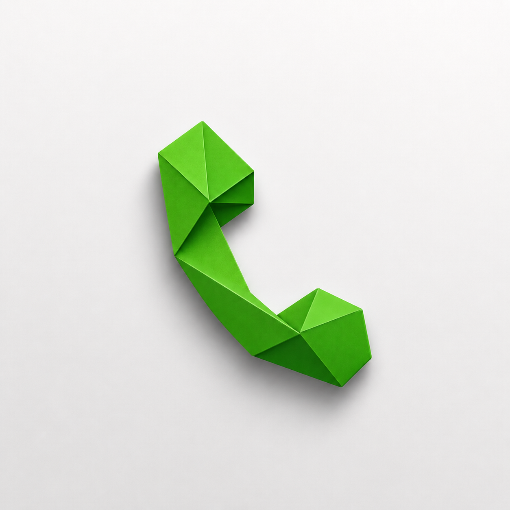

<div align="center">
  
  <h1>ZapDial</h1>
  <p><b>A minimalist, distraction-free, and high-performance default phone dialer and launcher built for Android.</b></p>

  <p>
    
    
    
    
    
  </p>
</div>

---

## 📱 About ZapDial

**ZapDial** is an open-source, beautifully crafted modern Android phone dialer designed as a clean, senior-friendly alternative to bloated stock dialers. Blending a Material 3 design system with buttery-smooth iOS-inspired gesture interactions, ZapDial provides lightning-fast search, zero clutter, and rock-solid native telecom integration.

---

## ✨ Core Features & Highlights

- **1:1 Clean Material / iOS Hybrid Aesthetic:** Features soft off-white backgrounds (`#FDFCFA`), pure white cards (`#FFFFFF`), desaturated pastel contact avatars, and muted slate typography.
- **Smart Predictive T9 & Live Keypad Search:** Instantly matches contacts as you type digits, with an inline, full-width one-tap **"+ Add to Contacts"** action.
- **Fluid A-Z Fast Scroller:** An interactive right-edge alphabet rail complete with haptic feedback and a dynamic scale-in HUD bubble indicator.
- **Bi-Directional Incoming Call Screen:** An iOS-inspired full-screen incoming call handler with fluid gesture physics (slide-to-silence and dual-direction slide to answer/decline) and glowing ambient lighting.
- **Advanced Call Recording:** Built-in local audio capture engine using `MediaRecorder` with timestamped, high-quality `.m4a` storage.
- **Robust Dual-SIM & Telecom Routing:** Full support for `SubscriptionManager` carrier detection, custom SIM preferences ("Ask every time"), and multi-party conference call merging.
- **Mistouch Prevention:** Optional confirmation dialogs to prevent accidental call triggers.
- **Categorized Recent Call Logs:** Clean, time-based history grouping (*Today, Yesterday, This Month, Older*) with expandable quick actions for viewing history or editing contacts.

---

## 🛠️ Tech Stack & Architecture

- **Language:** 100% Kotlin
- **UI Toolkit:** Jetpack Compose (Material 3)
- **Telecom Framework:** Android `InCallService` and `TelecomManager` APIs
- **Concurrency:** Kotlin Coroutines & Flow (`Dispatchers.IO` background processing)
- **Data Layer:** Android `ContentResolver` (Call Logs & Contacts Providers), `SharedPreferences`
- **Media Processing:** Native `MediaRecorder` for call audio capture

---

## 🚀 Getting Started & Local Setup

### 1. Clone the Repository

```bash
git clone https://github.com/ultra-titan/ZapDial.git
````

### 2\. Open in Android Studio

* Select Open and point to the cloned directory.

* Allow Gradle to sync and download the required dependencies (Target SDK 36 / Min SDK 24).

### 3\. Run the App

* Connect a physical Android device or start an emulator (API 24+).

* Click Run 'app'.

* Upon first launch, grant the required permissions and set ZapDial as your default system phone handler.

### 📸 Screenshots & UI Preview

| Home Screen & Favorites     | Smart Dialpad Search      | Incoming Call Screen      |
| --------------------------- | ------------------------- | ------------------------- |
| Clean Recents & Fast Search | Predictive T9 & Quick Add | Fluid Gestures & iOS Feel |

### 📜 License

ZapDial is open-source software released under the MIT License. Feel free to fork, modify, and build upon it!

```

